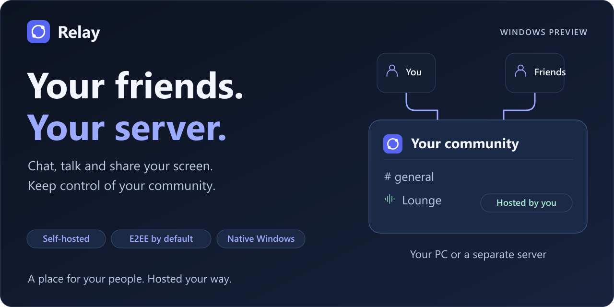

<b>Windows x64 · 18. oktober 2026 · Stereo- og opkaldspreview</b> 
<a href="#kom-i-gang">Kom i gang</a> · <a href="#opdater-din-installation">Opdatering</a> · <a href="SIKKERHED.md">Sikkerhed</a> · <a href="https://github.com/TheBengine/Relay/releases/tag/v0.10.0-preview.20261018.1">Nyt i denne udgave</a>

---

**Chat, tale og skærmdeling i en velkendt brugerflade — med jeres egen server.**

Relay er til venner, der vil snakke, spille og dele skærm, mens de selv bestemmer, hvor deres fællesskab bor. Serveren kan køre på en af jeres pc’er og styres gennem appen. I skal kun åbne **Relay**; hjælpeprogrammerne håndteres i baggrunden.

### Vælg din download

| | Fil | Til dig, der… |
| --- | --- | --- |
| **Anbefalet** | [**Relay-Setup.exe**](https://github.com/TheBengine/Relay/releases/download/v0.10.0-preview.20261018.1/Relay-Setup.exe) | Vil installere eller opdatere som et almindeligt Windows-program. |
| Valgfri | [**Relay-Portable.zip**](https://github.com/TheBengine/Relay/releases/download/v0.10.0-preview.20261018.1/Relay-Portable.zip) | Vil pakke ud selv. Behold hele mappen samlet, og åbn `Relay.exe`. |
| Kontrolkoder | [SHA256SUMS.txt](https://github.com/TheBengine/Relay/releases/download/v0.10.0-preview.20261018.1/SHA256SUMS.txt) | Vil kontrollere, at downloadet matcher udgivelsen. |

> Udgaven er en **usigneret preview**. Windows kan vise en advarsel. Praktiske opkald mellem to pc’er på forskellige netværk og fysisk kamera-/lydudstyr mangler stadig afprøvning.

**Nyt: stereolyd og mere stabile opkald.** Delt programlyd bevarer venstre og højre kanal og følger pc’ernes lydtempo mere jævnt. Rettet opkald, der kunne hænge under tilslutning, og gamle videobilleder, der kunne dukke op efter Stop. De tidligere lyd-, mikrofon- og iroh-forbedringer er med. De nye forløb er prøvet lokalt med kunstige medier; lytteprøve og opkald mellem to hjem mangler fortsat. [Se ændringerne og prøvernes omfang](https://github.com/TheBengine/Relay/releases/tag/v0.10.0-preview.20261018.1).

## Kom i gang

1. **Vælg dit navn.** Første start spørger om det navn, du vil bruge.
2. **Opret eller deltag.** Vælg **Create a server** for at være vært, eller **Join friends**, hvis du har en invitation. Ved oprettelse vælger du kryptering; end-to-end-kryptering er anbefalet og forvalgt.
3. **Invitér vennerne.** Værten åbner **Invite friends**, vælger **Share and copy invitation** og sender invitationen. Vennerne opretter deres egen konto på serveren.

**Bruger du allerede Tailscale?** Åbn **Invite friends → Change connection** på sidste trin for at vælge **Without accounts (iroh)** eller **With Tailscale**. Relay viser den aktuelle forbindelse. Kopiér en ny invitation efter et skift.

**Værtscomputeren skal være tændt**, mens vennerne bruger serveren. Jeres server behøver ikke køre hos projektets skaber.

<b>Hvilken forbindelse skal jeg vælge?</b>

- **Share and copy invitation:** iroh-forbindelsen til chat, tale, kamera og skærmdeling, uden en ekstra netværkskonto. Den kan bruge en ekstern relæserver, hvis direkte forbindelse ikke lykkes. Begge pc’er skal bruge denne udgave til de nye mediefunktioner.
- **Tailscale:** Den indbyggede private netværksvej til bl.a. video og skærmdeling. Begge logger ind med deres egen Tailscale-konto og godkender delingen; en separat Tailscale-app er ikke nødvendig.
- **Direkte adresse:** Til samme netværk eller en serveradresse, der allerede kan nås. Offentlig hosting kan kræve yderligere netværksopsætning.

Relay kan automatisk vælge mellem de veje, invitationen tilbyder. De nye forbindelsesvalg er softwaretestet lokalt; de er endnu ikke godkendt gennem et rigtigt opkald mellem to hjem.

## Det får I

| Samtaler | Tale og deling | Jeres fællesskab |
| --- | --- | --- |
| Kanaler, DMs og grupper | Mikrofonvalg og push-to-talk | Lokal server gennem appen |
| Svar, reaktioner og tråde | Støjreduktion og lydstyrker | Roller og rettigheder |
| Filer og GIF-søgning | Kamera og skærmdeling | Profil- og serverindstillinger |
| Søgning på din egen pc | Kvalitetsvalg op til 4K/60 fps* | Temaer og justerbar tekststørrelse |

*Tilgængelige valg er ikke en garanti for opnået kvalitet; hardware, netværk og den valgte forbindelsesvej sætter grænser.*

## Kryptering uden kodebøvl

**End-to-end-kryptering er standard.** Nye engangsinvitationer kan bekræfte værtens og vennens enhed automatisk. I kan bagefter sammenligne det samme sikkerhedsnummer under **Settings → Encryption** gennem et kendt opkald eller personligt.

En tidligere lokal prøve af invitationsarbejdet (16. oktober) med to friske profiler fik vennens besked frem hos værten **6,2 sekunder efter kontooprettelsen**, uden manuel kodeudveksling. Det er et testresultat på én pc, ikke en garanti for internetforsinkelse.

Værten kan vælge åben tilstand for beskeder, filer og opkald. Hver deltager skal selv acceptere, før deres app sender uden end-to-end-beskyttelsen. **Åbent indhold kan læses af serveren.** iroh- eller Tailscale-forbindelsen er stadig krypteret; det er et andet lag end Relays end-to-end-kryptering. [Læs den korte sikkerhedsforklaring →](SIKKERHED.md)

## Opdater din installation

1. Luk Relay-vinduet.
2. Hent **Relay-Setup.exe**, og kør den oven på installationen. Installeren kan stoppe installationens lokale server med **Stop my local server and continue**. Vennerne bliver afbrudt under opdateringen. Du behøver ikke afinstallere først.
3. Åbn Relay fra Startmenuen eller din genvej.

Installeren bevarer konti, indstillinger, nøgler og serverdata. Afinstallation sker gennem Windows’ **Installerede apps** og beholder dine data. Automatiske baggrundsopdateringer er endnu ikke aktiveret.

<b>Hvad mangler stadig?</b>

- Praktisk accept af deling, opkald og genforbindelse mellem to pc’er på forskellige netværk.
- Fysisk mikrofon, kamera, programlyd og længere streamingprøver.
- Praktisk afprøvning af de nye iroh-mediefunktioner på forskellige pc’er og netværk; lokale syntetiske prøver er gennemført.
- Pålidelig åbning af invitationer direkte fra alle browsere. Brug **Join friends** og indsæt linket, hvis browseren ikke åbner appen.
- Signeret distribution, automatiske opdateringer og uafhængigt sikkerhedsreview.

---

Dette repository indeholder projektets beskrivelse, grafik og downloadbare programmer. **Programkildekoden offentliggøres ikke her endnu.** Relay er et selvstændigt projekt uden tilknytning til Discord. Online GIF-søgning bruger GIPHY.
