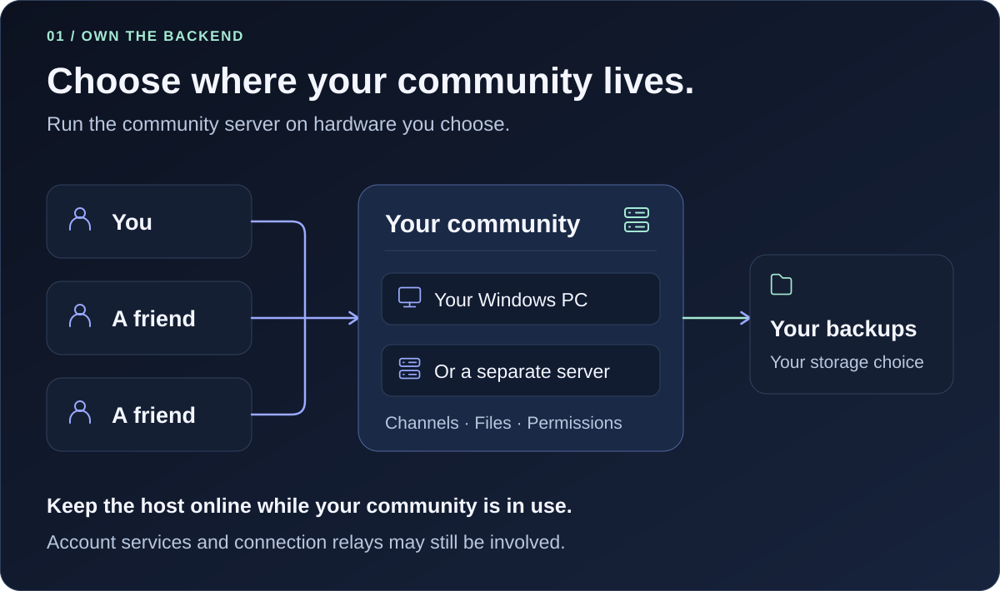
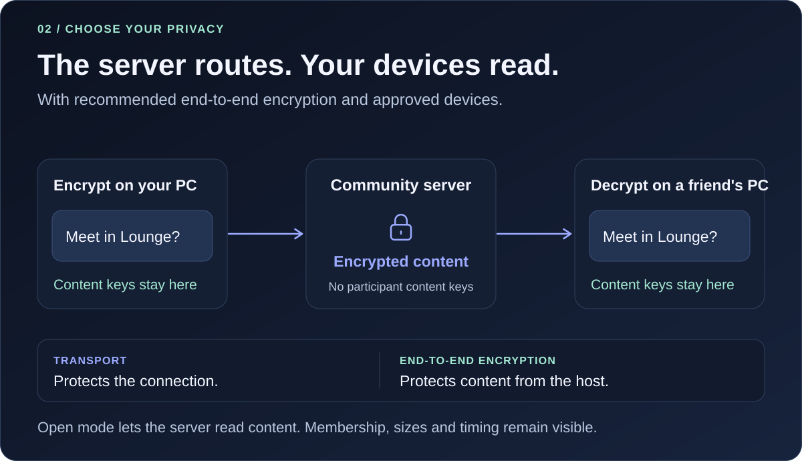
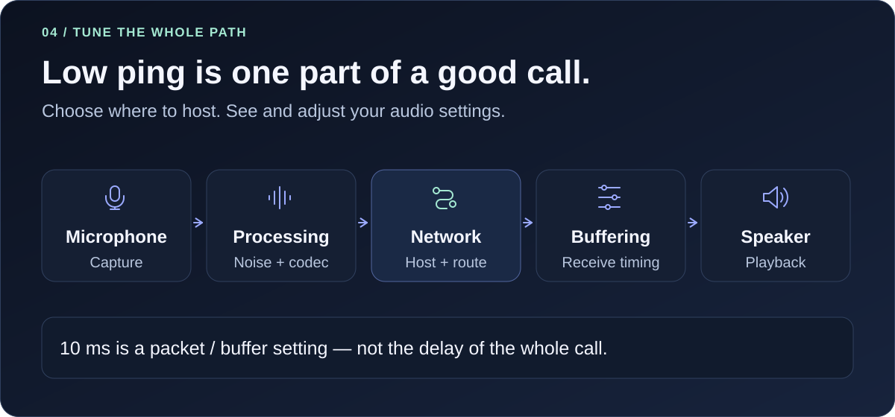
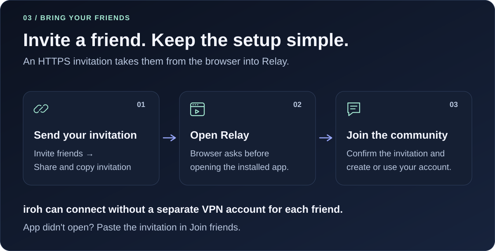

<picture>
  <source media="(max-width: 640px)" srcset="assets/relay-banner-compact.svg">
  
</picture>

<b>Windows x64 · Experimental preview</b> 
<a href="#get-started">Get started</a> · <a href="#why-relay">Why Relay?</a> · <a href="SECURITY.md">Privacy &amp; security</a> · <a href="https://github.com/TheBengine/Relay/releases/tag/v0.10.0-preview.20261018.1">Release notes</a>

**Chat, talk and share your screen with friends — on a server you control.**

Relay brings text channels, voice rooms, direct messages and screen sharing to a native Windows app. Host your community on your own PC or another machine. Open **Relay**; the local server and connection helpers are managed in the background.

## Why Relay?

**Choose the home for your community. Keep the controls familiar.** Relay is for friends who want channels, calls and sharing with control over the community backend.

| What you control | What that gives you |
| --- | --- |
| **Where the server lives** | Host on your Windows PC or keep a separate machine online. |
| **Community data and backups** | Choose the storage and keep your own recovery copies. |
| **Privacy and audio settings** | Recommended end-to-end encryption, device checks and adjustable call controls. |

<picture>
  <source media="(max-width: 640px)" srcset="assets/relay-hosting-compact.svg">
  
</picture>

### Private content, with a clear choice

End-to-end encryption is the recommended default for messages, files and calls. Approved participant devices hold the content keys. The server still sees metadata such as membership, sizes and timing.

<picture>
  <source media="(max-width: 640px)" srcset="assets/relay-privacy-compact.svg">
  
</picture>

An owner can explicitly choose an open community, and participants must accept before sending without Relay's end-to-end protection. **The server can read open content.** The iroh or Tailscale connection remains encrypted. [Understand the privacy choices](SECURITY.md).

### Your hosting choice. More control over the call.

iroh can connect friends without an extra networking account, using a relay if a direct connection is unavailable. Tailscale and direct addresses are also options. You choose where your community server runs; the actual route still depends on the networks involved.

Relay's desktop interface is built in Rust with egui. Microphone level, noise reduction, voice activity, push-to-talk and buffering controls let you adjust the call to your setup.

<picture>
  <source media="(max-width: 640px)" srcset="assets/relay-call-path-compact.svg">
  
</picture>

A nearby server and a direct route can help latency. **Lower ping, better sound, and lower RAM or CPU use than Discord have not been established.** We will publish comparisons with matched devices, versions, routes and workloads, including the local server and helpers when hosting.

### Voice and sharing without a Relay subscription

The included microphone, camera, screen-sharing and quality controls do not require a Relay subscription. Quality options extend up to 4K/60 FPS; achieved quality depends on hardware, connection and load. This is still an experimental preview.

**A fair comparison with Discord:** Discord also provides end-to-end encrypted audio/video calls through [DAVE](https://support.discord.com/hc/en-us/articles/25968222946071-End-to-End-Encryption-for-Audio-and-Video). Relay's self-hosting and control over the community backend are the distinction here. Relay has a much smaller feature set and validation history.

## Performance: measured claims only

| Question | Current evidence |
| --- | --- |
| Does Relay use less RAM? | No comparable Relay/Discord measurement published yet. |
| Does Relay use less CPU? | No comparable idle, voice and screen-sharing measurements published yet. |
| Are voice and video faster? | No controlled two-PC Relay/Discord comparison published yet. |
| What does “10 ms” mean? | An audio packet/buffering setting, not total call latency or internet ping. |

Comparisons need the same PCs, devices, network, media settings and workload, with app versions and connection routes recorded. Media tests should report median and 95th-percentile delay alongside interruptions and quality. Idle RAM, network ping or one successful call cannot establish an overall advantage.

## Download

| Package | Best for |
| --- | --- |
| [**Relay-Setup.exe**](https://github.com/TheBengine/Relay/releases/download/v0.10.0-preview.20261018.1/Relay-Setup.exe) | Recommended: install or update Relay like a normal Windows app. |
| [Relay-Portable.zip](https://github.com/TheBengine/Relay/releases/download/v0.10.0-preview.20261018.1/Relay-Portable.zip) | Extract the whole folder and open `Relay.exe`. Keep the files together. |
| [SHA256SUMS.txt](https://github.com/TheBengine/Relay/releases/download/v0.10.0-preview.20261018.1/SHA256SUMS.txt) | Check that downloaded files match the release. |

This is an **unsigned preview**. Real audio hardware, extended streaming and calls between different homes still need practical acceptance. Local synthetic media tests do not establish that these work on every PC or network.

## Get started

1. **Choose your name.** Relay asks for your preferred name on first launch.
2. **Create or join.** Choose **Create a server**, or **Join friends** if you have an invitation. Server creation offers an encryption choice; end-to-end encryption is recommended and selected by default.
3. **Invite your friends.** The host opens **Invite friends → Share and copy invitation**, then sends the invitation. Friends create their own account on that community.

<picture>
  <source media="(max-width: 640px)" srcset="assets/relay-invitation-compact.svg">
  
</picture>

With an HTTPS invitation and Relay installed, your friend chooses **Open Relay** in the browser. Already have a `relay://` invitation? The [invitation page](https://thebengine.github.io/Relay/) can turn it into a clickable link. Pasting the original invitation in **Join friends** remains available.

**Keep the host computer on.** Closing or updating the host interrupts access while its server is stopped. A private LAN address alone will not connect a friend in another home.

<b>Connection choices</b>

- **Without accounts (iroh):** chat, voice, camera and screen sharing without a separate networking account. An external relay may be used if direct connectivity is unavailable. Both PCs need the updated media-capable preview.
- **With Tailscale:** both friends sign in with their own Tailscale accounts and accept sharing. A separate Tailscale app is not required.
- **Direct address:** for the same network or a server that is already reachable. Public hosting can require additional network configuration.

Use **Invite friends → Change connection** to change the route, then copy a new invitation. Relay can choose between routes included in an invitation. If a browser does not open the app, use **Join friends** and paste the invitation.

## What is included?

| Conversations | Voice & sharing | Your community |
| --- | --- | --- |
| Channels, DMs and groups | Microphone selection and push-to-talk | Local server managed through the app |
| Replies, reactions and threads | Noise reduction and volume controls | Roles and permissions |
| Files and GIF search | Camera and screen sharing | Profile and server settings |
| Search on your own PC | Quality controls | Themes and adjustable text size |

New one-use invitations can confirm the host's and friend's devices automatically. Send them through a trusted contact route. You can compare the security number under **Settings → Encryption**, in person or over a call you already trust.

## Update Relay

1. Close the Relay window.
2. Run the newer **Relay-Setup.exe** over your installation. The installer offers **Stop my local server and continue** for the installation's local server. Friends will be disconnected during the update.
3. Open Relay from the Start menu or your shortcut. Update both PCs for media fixes.

The installer preserves accounts, settings, device keys and server data. Uninstalling through Windows also leaves your data. Automatic background updates are not enabled.

## Current limits

- Windows only, experimental and unsigned; no independent security review of Relay's integration yet.
- Hardware listening tests, long camera/screen-sharing sessions and reliable WAN reconnects still need practical acceptance.
- Newer development work is not automatically included in the download. The published preview currently uses private rooms that both participants join; incoming-call ringing and later account work should not be assumed to be released.
- Losing local device keys cannot be repaired with an account password or server backup alone.
- Public connection helpers and relays can still be involved. Self-hosted does not mean every connection is direct or independent of all infrastructure.

---

This repository contains the project's presentation, artwork and downloadable programs. **The application source is not published here yet.** Relay is independent of Discord. Online GIF search uses GIPHY.
