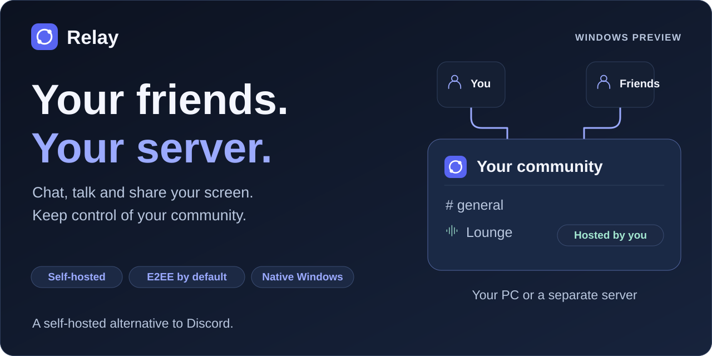

<picture>
  <source media="(max-width: 640px)" srcset="assets/relay-banner-compact.svg">
  
</picture>

**[Download for Windows](https://github.com/TheBengine/Relay/releases/download/v0.10.0-preview.20261025.2/Relay-Setup.exe)** · [Portable version](https://github.com/TheBengine/Relay/releases/download/v0.10.0-preview.20261025.2/Relay-Portable.zip)

Experimental, unsigned Windows x64 preview.

## Relay vs Discord

**More control. Private text. No Relay subscription for quality settings.**

| What matters | Relay | Discord |
| --- | --- | --- |
| **Hosting & data** | You control the server and backups | Hosted by Discord |
| **Text privacy** | End-to-end encrypted in protected mode | No text E2EE |
| **4K / 60 FPS settings** | Included without a Relay subscription | Nitro feature |

End-to-end encryption is optional for each server. New servers use standard mode with E2EE off by default. Keep your host online. Actual video quality depends on hardware and connection.

[Full comparison & sources](COMPARISON.md) · [Setup & updates](GUIDE.md) · [Privacy & security](SECURITY.md)
## Source and contributions

Relay's client, server, connection helpers and reviewed dependency patches are
now available in this repository under **PolyForm Perimeter 1.0.0**.
You can inspect the code and contribute fixes. Using the covered code to offer a
competing product is excluded, including free competing products. This is
**source available**, rather than OSI open source.

[License and earlier MIT rights](LICENSING.md) · [Contribute](CONTRIBUTING.md) ·
[Build from source](docs/building.md)

The latest preview includes the matching application source. Hardware, WAN latency
and resource-usage comparisons still require measurements on real devices.
